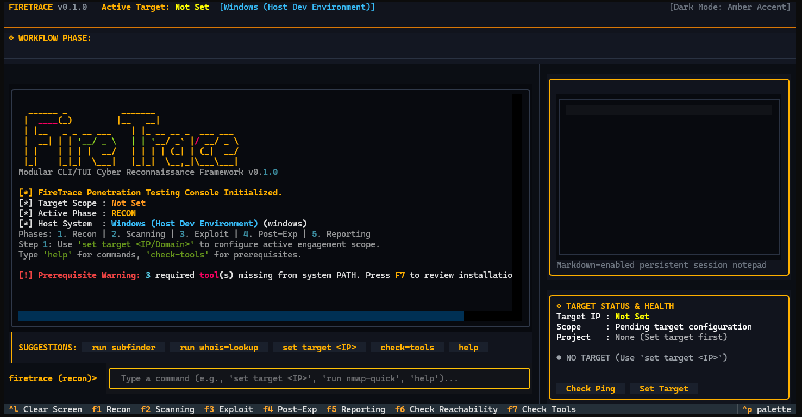

# FireTrace

> **Modular Terminal User Interface (TUI) for Penetration Testing & Surface Reconnaissance**

[](https://www.python.org/downloads/)
[](LICENSE)
[](https://textual.textualize.io/)
[](https://docs.astral.sh/uv/)



**FireTrace** is a lightweight, dark-mode terminal reconnaissance console built with Python and the [Textual](https://textual.textualize.io/) framework. It serves as a unified, asynchronous wrapper around industry-standard security tools (`nmap`, `feroxbuster`, `ffuf`, `nuclei`, `subfinder`), providing real-time streaming output, an interactive scratchpad, and a cross-distro prerequisite checker.

---

## Key Features

- **Asynchronous Real-Time Streaming:** Executes underlying security binaries non-blockingly using `asyncio.create_subprocess_exec` and streams `stdout`/`stderr` line-by-line directly into the terminal log without freezing the interface.
- **Cross-Distro Prerequisite Checker:** Inspects `/etc/os-release` and checks your system `$PATH` via `shutil.which` to provide copy-paste installation commands tailored to your package manager (`apt`, `pacman`, `dnf`, `apk`, or Go/binary release).
- **Injection-Safe Command Factory:** Arguments are constructed as discrete argument vectors, strictly avoiding `shell=True` to eliminate shell injection vulnerabilities.
- **Penetration Testing Lifecycle:** Organized into official assessment phases:
  1. **Recon** (Passive OSINT, subdomains, WHOIS)
  2. **Scanning** (Network discovery, port auditing, web directories)
  3. **Exploit** (Vulnerability verification, CVE templates)
  4. **Post-Exp** (Privilege escalation auditing, credential extraction)
  5. **Reporting** (Artifact collection and Markdown report compilation)
- **Persistent Session Scratchpad:** Vertical note-taking pane anchored to the top-right corner for recording observations, discovered endpoints, and credentials during active assessments.

---

## Architecture Overview

```text
┌────────────────────────────────────────────────────────────────────────────────────────┐
│ FIRETRACE v0.1.0                 Active Target: Not Set             [Kali GNU/Linux]   │
├────────────────────────────────────────────────────────────────────────────────────────┤
│ ◈ WORKFLOW PHASE: (●) Recon   ( ) Scanning   ( ) Exploit   ( ) Post-Exp   ( ) Reporting│
├───────────────────────────────────────────────────────┬────────────────────────────────┤
│ MAIN CONSOLE AREA (Center/Left: 68% Width)            │ NOTE-TAKING PANE (Top Right)   │
│ ┌───────────────────────────────────────────────────┐ │ ┌────────────────────────────┐ │
│ │ firetrace (recon)> set target 10.10.11.200        │ │ │                            │ │
│ │ [+] Target scope successfully configured.         │ │ │                            │ │
│ │ firetrace (scanning)> run nmap-quick              │ │ │ (Blank Session Scratchpad) │ │
│ │ [*] Spawning subprocess: nmap -sV -T4 ...         │ │ │                            │ │
│ │ [stdout streams in real time...]                  │ │ └────────────────────────────┘ │
│ ├───────────────────────────────────────────────────┤ ├────────────────────────────────┤
│ │ SUGGESTIONS: [run nmap-quick] [run feroxbuster]...│ │ TARGET STATUS (Bottom Right)   │
│ ├───────────────────────────────────────────────────┤ │ ┌────────────────────────────┐ │
│ │ firetrace (scanning)> [ Input Command           ] │ │ │ Target IP: 10.10.11.200      │ │
│ └───────────────────────────────────────────────────┘ │ │ Status: [● REACHABLE (14ms)] │ │
│                                                       │ └────────────────────────────┘ │
├───────────────────────────────────────────────────────┴────────────────────────────────┤
│ [Ctrl+C] Quit | [Ctrl+L] Clear Screen | [Ctrl+X] Abort Scan | [F1-F5] Phases | [F7] Tools│
└────────────────────────────────────────────────────────────────────────────────────────┘
```

---

## Quick Start

### Prerequisites

- Python 3.12+
- [`uv`](https://docs.astral.sh/uv/) (recommended) or standard `pip`

### Installation

```bash
# Clone repository
git clone https://github.com/<your-username>/FireTrace.git
cd FireTrace

# Sync virtual environment and dependencies using uv
uv sync

# Launch FireTrace TUI
uv run python app.py
```

*Alternatively, using standard Python:*

```bash
python3 -m venv .venv
source .venv/bin/activate
pip install -r <(uv pip compile pyproject.toml)
python3 app.py
```

---

## Supported Tools & Distro Compatibility

FireTrace automatically checks for tool availability on startup. If a tool is missing, press **F7** or type `check-tools` to view the one-line installation command for your distribution:

| Tool | Debian / Kali / Ubuntu (`apt`) | Arch / Manjaro (`pacman`) | Fedora / RHEL (`dnf`) |
| :--- | :--- | :--- | :--- |
| **Nmap** | `sudo apt install -y nmap` | `sudo pacman -S --noconfirm nmap` | `sudo dnf install -y nmap` |
| **Feroxbuster** | `sudo apt install -y feroxbuster` | `sudo pacman -S --noconfirm feroxbuster` | *Direct binary script / Cargo* |
| **ffuf** | `sudo apt install -y ffuf` | `sudo pacman -S --noconfirm ffuf` | `sudo dnf install -y golang-github-ffuf-ffuf` |
| **Subfinder** | `sudo apt install -y subfinder` | `sudo pacman -S --noconfirm subfinder` | `go install github.com/projectdiscovery/subfinder/v2/cmd/subfinder@latest` |
| **Nuclei** | `sudo apt install -y nuclei` | `sudo pacman -S --noconfirm nuclei` | `go install github.com/projectdiscovery/nuclei/v3/cmd/nuclei@latest` |
| **Whois** | `sudo apt install -y whois` | `sudo pacman -S --noconfirm whois` | `sudo dnf install -y whois` |

---

## Command Reference

| Command | Category | Description |
| :--- | :--- | :--- |
| `set target <IP/Domain>` | Global | Configure active engagement target scope |
| `run nmap-quick` | Scanning | Execute top-100 port discovery with service versioning |
| `run nmap-full` | Scanning | Full TCP 1–65535 scan with OS and script detection |
| `run feroxbuster` | Scanning | Recursive web directory brute-forcing |
| `run ffuf-dirs` | Scanning | Wordlist fuzzing against target endpoints |
| `run subfinder` | Recon | Passive OSINT subdomain enumeration |
| `run nuclei-cve` | Exploit | Template vulnerability scan against target |
| `ping` | Global | Execute real ICMP round-trip probe to test reachability |
| `abort` / `Ctrl+X` | Global | Send SIGTERM/SIGKILL to cancel active scan process |
| `check-tools` / `F7` | Global | Re-check prerequisite status and open install modal |
| `clear` / `Ctrl+L` | Global | Clear the terminal log buffer |

---

## Keybindings

- **`F1` – `F5`**: Switch workflow phases (Recon, Scanning, Exploit, Post-Exp, Reporting)
- **`F6`**: Probe target reachability (ICMP)
- **`F7`**: Open Prerequisite Validation Modal
- **`Ctrl+X`**: Abort currently executing subprocess
- **`Ctrl+L`**: Clear terminal console
- **`Ctrl+C`**: Quit application

---

## Running Tests

Automated tests can be executed via:

```bash
uv run python -m unittest discover tests/
```

---

## Legal & Ethical Disclaimer

> **IMPORTANT:** FireTrace is designed strictly for authorized penetration testing, security auditing, and educational research on systems and networks you own or have explicit written permission to test. Unauthorized scanning or testing of third-party infrastructure may violate local, national, and international laws. The authors and contributors assume no liability for misuse or damage caused by this software.

---

## License

This project is licensed under the MIT License — see the [LICENSE](LICENSE) file for details.
